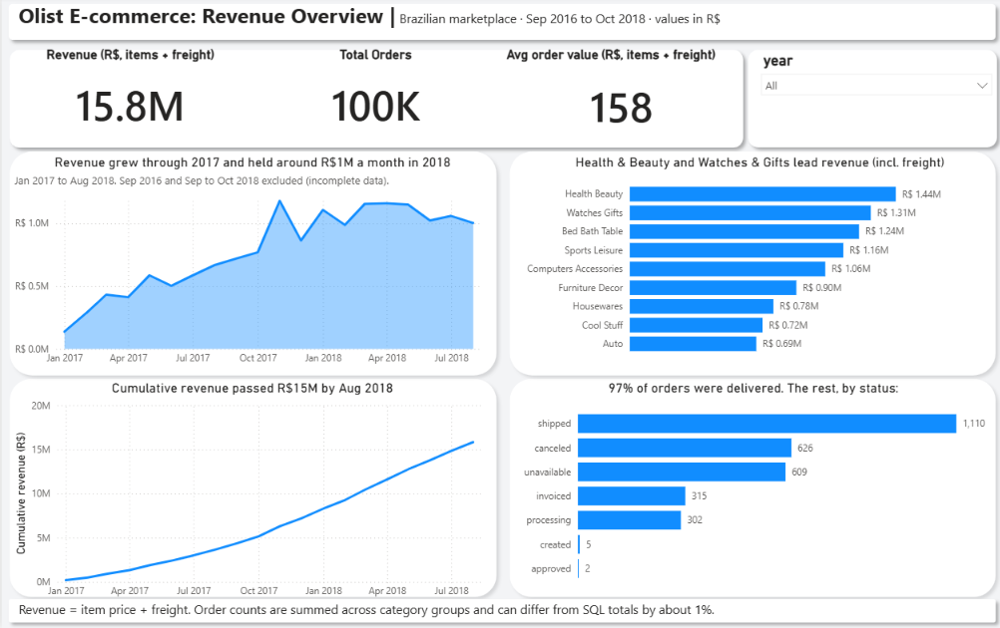
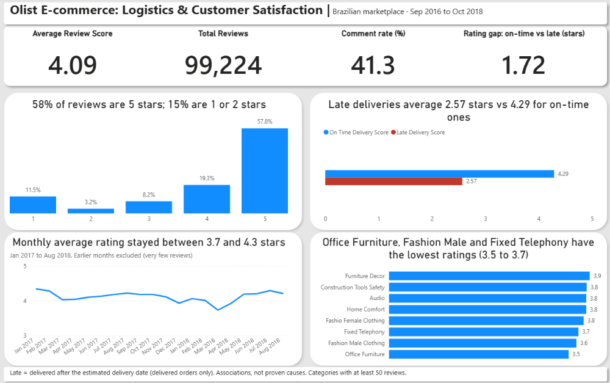

# 📊 Olist E-commerce Dashboard | Power BI

## 📌 Project Overview

A two-page Power BI dashboard on the Olist Brazilian e-commerce dataset (Sep 2016 to Oct 2018). It builds on my [Olist SQL analysis](https://github.com/Ayoub-LARBI/SQL_Project_Olist_E-Commerce_Dataset_Analysis): the analysis queries were written in PostgreSQL first, then their result sets were loaded into Power BI and turned into an interactive report.

1. **Page 1: Revenue Overview**: revenue, orders, monthly and cumulative revenue, top categories, and order fulfillment status.
2. **Page 2: Logistics & Customer Satisfaction**: review scores, on-time vs late delivery ratings, the monthly rating trend, and the lowest-rated categories.

Check out the PowerBI dashboard here : [dashboard](dashboard)

---

## 📸 Dashboard Previews

### 🔹 Page 1: Revenue Overview


### 🔹 Page 2: Logistics & Customer Satisfaction


---

## 🎯 Questions the Dashboard Answers

### 💰 Revenue Overview
* How much revenue did the marketplace generate, and how did it grow month by month?
* Which product categories generate the most revenue?
* What share of orders were delivered, and what happened to the rest?

### 🚚 Logistics & Customer Satisfaction
* How satisfied are customers overall, and how are the ratings distributed?
* Do late deliveries receive lower ratings than on-time ones?
* Did satisfaction hold up over time?
* Which product categories receive the lowest ratings?

---

## 📊 Key Findings

### 💰 Revenue (item price + freight)
* Total revenue is **R$15.8M** (R$15,843,553) across the full period.
* Monthly revenue grew through 2017, peaked in Nov 2017 at about R$1.2M, and stayed around R$1M a month in 2018.
* **Health & Beauty (R$1.44M)** and **Watches & Gifts (R$1.31M)** lead category revenue.
* **97% of orders were delivered.** The rest: shipped 1,110, canceled 626, unavailable 609, invoiced 315, processing 302.

### ⭐ Customer Satisfaction
* The average review score is **4.09** across **99,224 reviews**. 57.8% are 5 stars and 14.7% are 1 or 2 stars.
* On-time deliveries average **4.29 stars** vs **2.57** for late ones, a 1.72-point gap.
* The monthly average rating stayed between 3.7 and 4.3 stars (Jan 2017 to Aug 2018).
* The lowest-rated categories (at least 50 reviews) are Office Furniture (3.5), Fashion Male Clothing (3.6) and Fixed Telephony (3.7).

Ratings are associated with delivery performance. This is observational data, so it does not prove that late delivery caused the lower scores.

---

## 🛠️ Data Pipeline: PostgreSQL to Power BI

The analysis logic lives in PostgreSQL. Power BI loads the result sets of three queries from `sql_queries/`:

1. **`01_executive_sales_performance.sql`**: monthly revenue aggregates and running totals (Page 1).
2. **`02_logistics_satisfaction_deepdive.sql`**: review metrics by category and delivery timing (Page 2).
3. **`03_global_satisfaction_kpis.sql`**: overall review KPIs (average score, total reviews, comment rate) for the Page 2 cards.

The review score distribution chart uses the review-level `Order Reviews` table.

### 🔌 How to Load the Data
1. Open **Power BI Desktop** and go to **Get Data > PostgreSQL database**.
2. Enter your server and database, then open **Advanced options**.
3. Paste one query from `sql_queries/` into the SQL statement box and click **Load**. Repeat for each query.
4. Select the text `month` column, go to **Column tools > Sort by column** and choose `month_date`, so charts are in chronological order.

---

## 🧮 Key DAX Measures

```DAX
Total Revenue = SUM('Sales & Revenue Data'[revenue])

Total Orders = SUM('Sales & Revenue Data'[total_orders])

Average Order Value = DIVIDE([Total Revenue], [Total Orders])

Cumulative Revenue =
CALCULATE(
    [Total Revenue],
    FILTER(
        ALL('Sales & Revenue Data'[month_date]),
        'Sales & Revenue Data'[month_date] <= MAX('Sales & Revenue Data'[month_date])
    )
)

Delivered % =
DIVIDE(
    CALCULATE([Total Orders], 'Sales & Revenue Data'[order_status] = "delivered"),
    CALCULATE([Total Orders], ALL('Sales & Revenue Data'[order_status]))
)

Reviews = COUNTROWS('Order Reviews')

Review Share % =
DIVIDE(
    [Reviews],
    CALCULATE([Reviews], ALL('Order Reviews'[review_score]))
)

Delivery Rating Gap =
AVERAGE('Review Data'[avg_score_on_time]) - AVERAGE('Review Data'[avg_score_late])
```

The fulfillment chart title is a measure too (`Fulfillment Title`), so it updates with the data.

---

## ⚠️ Data Notes and Limitations

* **Revenue basis:** Page 1 revenue is item price + freight (R$15.84M). My [SQL project](ADD-SQL-REPO-URL) reports R$16.0M, which is recorded payments (`payment_value`). The two totals differ by about 1%.
* **Order counts:** Page 1 order counts are summed across category groups, so an order with items in two categories is counted twice. Totals can exceed distinct orders by roughly 1% (about 100K here vs 99,440 in SQL). Review counts on Page 2 are exact (99,224).
* **Time range:** trend charts show Jan 2017 to Aug 2018. 2016 and Sep to Oct 2018 have very few orders or reviews and are excluded.
* **Definitions:** a delivery is late if it arrived after the estimated delivery date. Only delivered orders are included. Category ratings include only categories with at least 50 reviews.
* **Not causal:** ratings and delivery timing are associated, not proven to be cause and effect.
* **Revenue is not profit:** the dataset has no cost data.

---

## 🧠 Skills Demonstrated

* **SQL to Power BI workflow:** analysis written in PostgreSQL, result sets loaded into a report.
* **DAX:** measures, a running total with `CALCULATE`, `FILTER` and `ALL`, safe division with `DIVIDE`, and a chart title driven by a measure.
* **Validation:** dashboard totals were checked against SQL results (99,224 reviews, 4.09 average score, 41.3% comment rate, 4.29 vs 2.57 stars). The Page 1 differences are documented above.
* **Dashboard design:** the same layout on both pages, insight-style titles, one accent color, and footnotes that state definitions.

---

## 📁 Project Structure

```text
📦 POWERBI_PROJECT
│
├── 📁 dashboard
│   └── 📊 Olist_E-Commerce_Dataset_Dashboard.pbix
│
├── 📁 data
│   └── 📄 [Raw Olist CSV dataset source files]
│
├── 📁 images
│   ├── 📸 page1_revenue_overview.png
│   └── 📸 page2_logistics_satisfaction.png
│
├── 📁 sql_queries
│   ├── 📄 01_executive_sales_performance.sql
│   ├── 📄 02_logistics_satisfaction_deepdive.sql
│   └── 📄 03_global_satisfaction_kpis.sql
│
└── 📘 README.md
<<<<<<< HEAD
```

---

## 👨‍💻 Author

**Ayoub Larbi**, Data Analyst / Statistical Engineer
[LinkedIn](https://linkedin.com/in/ayoublarbi) · [GitHub](https://github.com/Ayoub-LARBI)
=======
>>>>>>> e4ea4ebd438b06bcf9b4c17085a490e17ddc83e3
